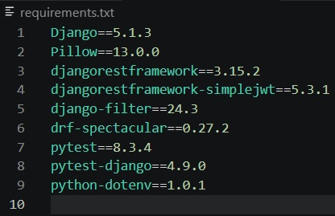
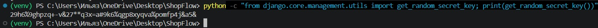
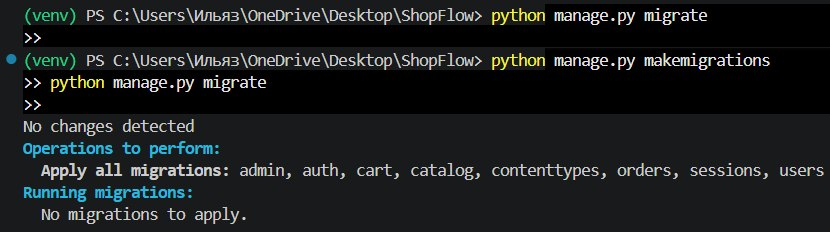
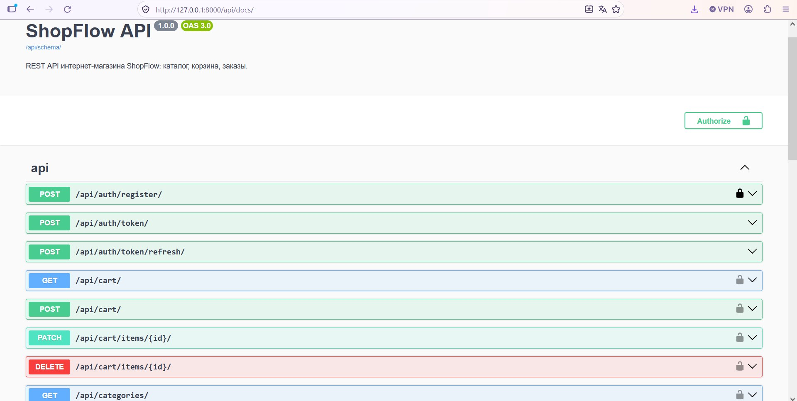
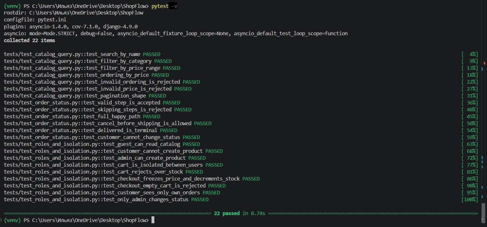
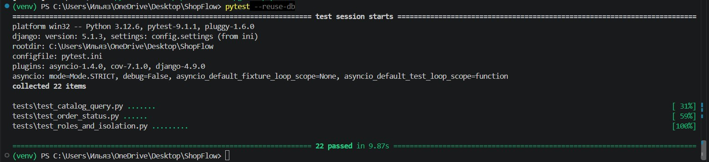
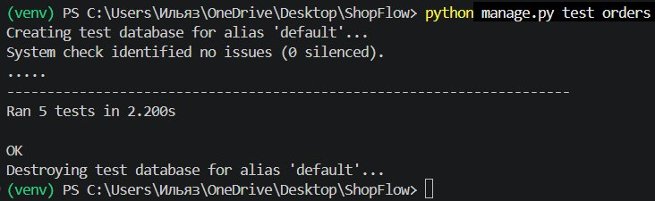

# ShopFlow

Интернет-магазин: REST API на Django REST Framework и адаптивный фронтенд.
Каталог товаров с поиском и фильтрами, персональная корзина и оформление заказов.
Аутентификация по JWT, роли CUSTOMER и ADMIN, изоляция данных между пользователями.

## Требования

- Python 3.12
- Django 5.1

## Запуск

1. Создать и активировать виртуальное окружение:

   ```bash
   python -m venv venv
   venv\Scripts\activate
   ```

   На Linux/macOS активация: `source venv/bin/activate`

2. Установить зависимости:

   ```bash
   pip install -r requirements.txt
   ```

   

3. Создать файл `.env` (можно скопировать из `.env.example`) и указать секретный ключ:

   ```env
   SECRET_KEY=любой-секретный-ключ
   DEBUG=True
   ALLOWED_HOSTS=localhost,127.0.0.1
   ```

   Сгенерировать ключ:

   ```bash
   python -c "from django.core.management.utils import get_random_secret_key; print(get_random_secret_key())"
   ```

   

4. Применить миграции:

   ```bash
   python manage.py migrate
   ```

   

5. Создать суперпользователя:

   ```bash
   python manage.py createsuperuser
   ```

   Тестового суперпользователя в проекте нет, логин и пароль задаются при создании.

6. Запустить сервер:

   ```bash
   python manage.py runserver
   ```

   Сайт: http://127.0.0.1:8000/, админка: http://127.0.0.1:8000/admin/

## Документация API

Swagger UI с интерактивным тестированием: http://127.0.0.1:8000/api/docs/



Для защищённых запросов нужен JWT: получить токен в `POST /api/auth/token/`,
затем в Swagger нажать **Authorize** или передавать заголовок `Authorization: Bearer <token>`.

## Основные URL

- `/` — главная
- `/api/auth/register/` — регистрация
- `/api/auth/token/`, `/api/auth/token/refresh/` — вход и обновление токена
- `/api/users/me/` — профиль текущего пользователя
- `/api/categories/`, `/api/categories/<id>/` — категории
- `/api/products/`, `/api/products/<id>/` — товары
- `/api/cart/`, `/api/cart/items/<id>/` — корзина
- `/api/orders/`, `/api/orders/<id>/` — заказы
- `/api/docs/` — документация
- `/admin/` — админка


## Фильтры каталога

Список товаров `GET /api/products/` поддерживает параметры:

- `search` — поиск по названию
- `category` — id категории
- `min_price`, `max_price` — диапазон цены
- `ordering` — сортировка: `price`, `-price`, `name`, `-name`, `created_at`, `-created_at`
- `page` — страница (по 20 товаров)

Пример: `/api/products/?search=phone&category=1&ordering=-price`

## Заказы

Заказ оформляется из корзины в `transaction.atomic()` с `select_for_update()`:
проверяются остатки, создаётся заказ с фиксацией текущей цены в позициях,
уменьшаются складские остатки и очищается корзина. При ошибке — полный откат.

## Тесты

Проект покрыт тестами на pytest: права и роли, фильтры каталога, лимиты stock,
изоляция данных и атомарность оформления заказа.

```bash
pytest -v
```



Повторные прогоны можно ускорить, переиспользуя тестовую БД:

```bash
pytest --reuse-db
```



Отдельно — тесты атомарности оформления заказа (полный откат при ошибке):

```bash
python manage.py test orders
```


